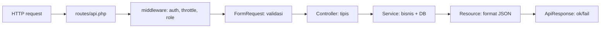

# Laravel Base Template

REST API starter. Auth + CRUD + test siap jalan. Copy pola `Product` untuk modul baru.

## Fitur

- Auth Sanctum: register, login, me, logout
- Contoh CRUD: products
- Respons seragam: `{ok, message, data}`
- Validasi via FormRequest, format via Resource, bisnis via Service
- Role middleware: `role:admin`
- Rate limit: login 5/menit, register 30/menit
- Test: 9 Feature test, SQLite memory

## Syarat

- PHP 8.3+
- Composer 2+
- MySQL 8+ atau SQLite (default dev)

## Mulai cepat

```bash
composer install
cp .env.example .env
php artisan key:generate
php artisan migrate --seed
php artisan test
php artisan serve --port=8010
```

Akun demo:

```text
admin@example.com / password123 (admin)
user@example.com / password123 (user)
```

> Email seed lihat [DatabaseSeeder.php](database/seeders/DatabaseSeeder.php). Ubah sebelum produksi.

## Coba API

```bash
# register
curl -X POST http://localhost:8010/api/v1/register \
  -H "Content-Type: application/json" \
  -d '{"name":"Budi","email":"budi@mail.com","password":"password123"}'

# login
curl -X POST http://localhost:8010/api/v1/login \
  -H "Content-Type: application/json" \
  -d '{"email":"budi@mail.com","password":"password123"}'

# me (ganti TOKEN)
curl http://localhost:8010/api/v1/me \
  -H "Authorization: Bearer TOKEN"

# buat produk
curl -X POST http://localhost:8010/api/v1/products \
  -H "Authorization: Bearer TOKEN" \
  -H "Content-Type: application/json" \
  -d '{"name":"Kopi","price":15000,"stock":10}'
```

## Struktur

```text
app/Http/Controllers/Api/  # terima request, panggil service, kembalikan respons
app/Http/Requests/         # validasi input
app/Http/Resources/        # format JSON keluar
app/Services/              # aturan bisnis + query DB
app/Models/                # Eloquent, relasi, cast
app/Traits/ApiResponse.php # helper ok() / fail()
routes/api.php             # daftar endpoint
database/migrations/       # skema tabel
database/seeders/          # data awal dev
tests/Feature/             # test endpoint
docs/                      # panduan lengkap
```

## Alur request



Detail: [docs/02-architecture.md](docs/02-architecture.md).

## Format respons

Sukses:

```json
{"ok": true, "message": "Product created", "data": {"id": 1}}
```

Gagal validasi:

```json
{"ok": false, "message": "Validation failed", "errors": {"name": ["required"]}}
```

Tabel kode: [docs/04-api-reference.md](docs/04-api-reference.md).

## Dokumentasi

- [01 Getting Started](docs/01-getting-started.md) — install sampai jalan
- [02 Architecture](docs/02-architecture.md) — alur + peran tiap folder
- [03 Adding Module](docs/03-adding-module.md) — tambah CRUD baru
- [04 API Reference](docs/04-api-reference.md) — daftar endpoint + contoh
- [05 Best Practices](docs/05-best-practices.md) — aturan clean code
- [06 Deployment](docs/06-deployment.md) — checklist produksi

## Perintah umum

```bash
php artisan test                    # semua test
php artisan test --filter=AuthTest  # satu file
./vendor/bin/pint                   # rapikan gaya kode
php artisan migrate:refresh --seed  # reset DB dev
```

## Pakai sebagai template

```bash
composer create-project laravel/laravel nama-app
# salin pola: ApiResponse, Service, Request, Resource, EnsureRole, bootstrap/app.php
```

Atau fork repo ini, hapus `products` contoh setelah paham pola.
