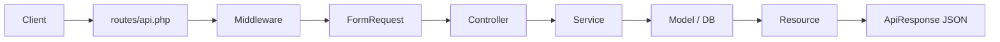

# 02 Architecture

Satu request jalan lewat lapisan ini. Tiap lapisan satu tugas.



## Lapisan

| Lapisan | File | Tugas | Boleh | Dilarang |
|---|---|---|---|---|
| Route | `routes/api.php` | daftarkan URL + middleware | `prefix`, `middleware`, `apiResource` | logika bisnis |
| Middleware | `app/Http/Middleware/` | cek sebelum controller | auth, throttle, role | query bisnis |
| Request | `app/Http/Requests/` | validasi input | `rules()`, `authorize()` | simpan DB |
| Controller | `app/Http/Controllers/Api/` | terima, panggil service, jawab | `validated()`, `ok()`, `fail()` | `DB::`, `where`, hitung harga |
| Service | `app/Services/` | aturan bisnis | query, transaksi, token | `response()->json` |
| Model | `app/Models/` | tabel + relasi + cast | `fillable`, `casts`, `hasMany` | format JSON |
| Resource | `app/Http/Resources/` | bentuk JSON keluar | pilih field, cast tipe | simpan DB |
| Response | `app/Traits/ApiResponse.php` | amplop seragam | `ok()`, `fail()` | bisnis |

## Contoh nyata

`POST /api/v1/products`:

1. Route cocokkan URL ke `ProductController@store`.
2. `auth:sanctum` cek token. Tanpa token = `401`.
3. `ProductRequest` cek `name`, `price`, `stock`. Gagal = `422`.
4. Controller panggil `$service->create($request->validated())`.
5. Service simpan via `Product::create()`.
6. `ProductResource` ubah model jadi JSON.
7. `ApiResponse::ok()` bungkus `{ok: true, message, data}`, kode `201`.

## Aturan JSON

Semua respons API ikut bentuk ini. Dibuat di `bootstrap/app.php` + `ApiResponse`.

Sukses:

```json
{"ok": true, "message": "OK", "data": {}}
```

Gagal:

```json
{"ok": false, "message": "Alasan", "errors": {}}
```

## Auth dan error

- Tanpa token: `401 {ok: false, message: "Belum login"}`
- Role salah: `403 {ok: false, message: "Akses ditolak"}`
- Validasi gagal: `422 {ok: false, message: "Validasi gagal", errors: {...}}`
- Terlalu sering: `429`
- Data tidak ada: `404`

Setting ada di [bootstrap/app.php](../bootstrap/app.php). Jangan cek auth manual di controller.

## Kapan tambah apa?

- Field input baru = ubah `Request` + `Resource` + migration.
- Aturan bisnis baru = ubah `Service`.
- Bentuk JSON baru = ubah `Resource` saja.
- URL baru = tambah route + controller method.
- Akses khusus admin = tambah `->middleware('role:admin')`.
